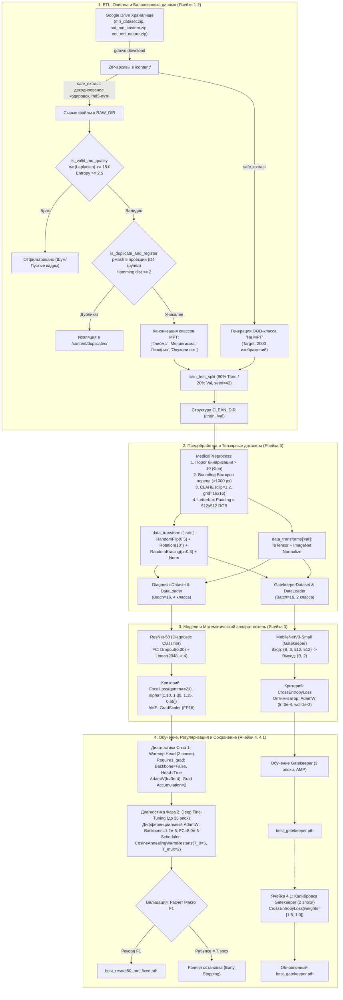
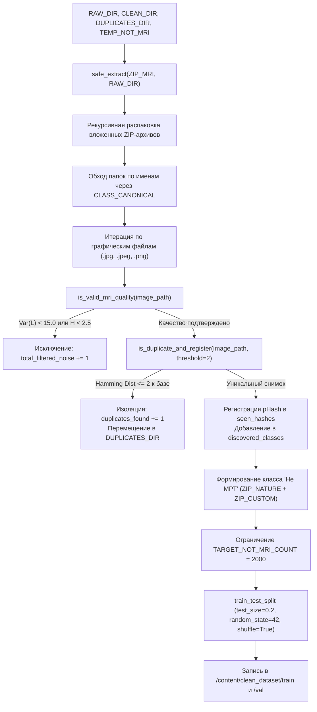
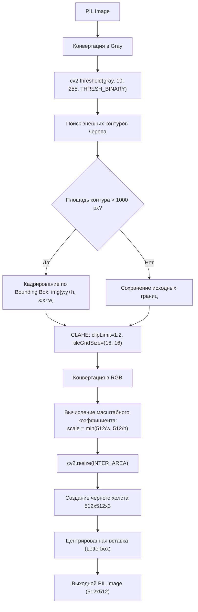
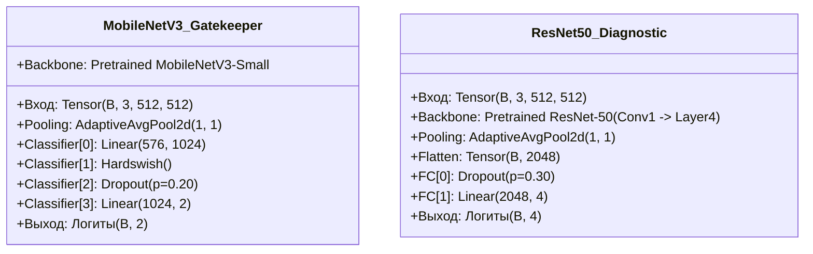
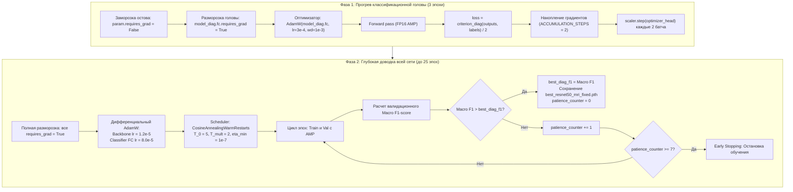
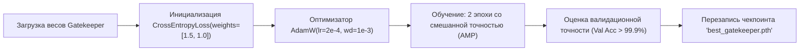

# mri-brain-tumors
Определение наличия и типов опухолей на мрт мозга
# Сегментация и классификация новообразований головного мозга по МРТ

Cистема для детекции и точной локализации опухолей головного мозга (глиома, менингиома, аденома гипофиза) по монохромным срезам МРТ.

[](https://colab.research.google.com/drive/1SDEL3CeAGaQHK7YNh-pnwKLbk5V6PXVR?usp=sharing)
[](https://colab.research.google.com/drive/12biIGSKEKvGF_6BlJyboRFQ5PzI0iJlq?usp=sharing)

---

## Быстрый запуск

Для оперативной проверки работы модели без ожидания обучения и скачивания датасетов:

1. Откройте блокнот **[test_ai.ipynb в Google Colab](https://colab.research.google.com/drive/1SDEL3CeAGaQHK7YNh-pnwKLbk5V6PXVR?usp=sharing)**.
2. В верхнем меню выберите **Среда выполнения (Runtime) -> Выполнить всё (Run all)**.
3. В выводе последней ячейки откроется веб-интерфейс Gradio с публичной ссылкой `*.gradio.live`.

---

# 🧠 Архитектура и технический разбор пайплайна обучения (Training Pipeline)

Данный документ содержит исчерпывающее техническое описание архитектуры, алгоритмов предварительной обработки данных, математического аппарата и протоколов обучения системы мультиклассовой диагностики патологий головного мозга по МРТ-сканам (`train_ai.ipynb` / `full_code_mri_ai.ipynb`).

---

## 📑 Содержание
1. [Общая архитектурная блок-схема (End-to-End Pipeline)](#1-общая-архитектурная-блок-схема-end-to-end-pipeline)
2. [Ячейка 1: Инфраструктура и загрузка сырых данных](#2-ячейка-1-инфраструктура-и-загрузка-сырых-данных)
3. [Ячейка 2: ETL, Санитизация, Фильтрация шумов и Дедупликация](#3-ячейка-2-etl-санитизация-фильтрация-шумов-и-дедупликация)
4. [Ячейка 3: Медицинский препроцессинг, Архитектуры сетей и Функции потерь](#4-ячейка-3-медицинский-препроцессинг-архитектуры-сетей-и-функции-потерь)
5. [Ячейка 4: Двухфазный протокол трансферного обучения классификатора](#5-ячейка-4-двухфазный-протокол-трансферного-обучения-классификатора)
6. [Ячейка 4.1: Калибровка входного фильтра Gatekeeper](#6-ячейка-41-калибровка-входного-фильтра-gatekeeper)
7. [Сводная таблица гиперпараметров и сигнатур](#7-сводная-таблица-гиперпараметров-и-сигнатур)

---

## 1. Общая архитектурная блок-схема (End-to-End Pipeline)



---

## 2. Ячейка 1: Инфраструктура и загрузка сырых данных

### 2.1. Назначение
Инициализирует окружение Google Colab, устанавливает актуальные версии библиотек компьютерного зрения и производит автоматическое скачивание архивов датасетов по прямым идентификаторам Google Drive.

```mermaid
flowchart LR
    A["Старт пайплайна"] --> B["Установка пакетов (albumentations, imagehash, opencv...)"]
    B --> C["Определение словаря DATASETS"]
    C --> D{"os.path.exists(dest_path)?"}
    D -- Нет -- > E["gdown.download(id, dest_path)"]
    D -- Да --> F["Пропуск загрузки"]
    E & F --> G["Архивы готовы к распаковке"]
```

### 2.2. Используемые переменные и структура словаря `DATASETS`
* `DATASETS` (`dict[str, str]`): маппинг локальных путей назначения и уникальных идентификаторов файлов Google Drive:
  * `"/content/mri_dataset.zip"` $\to$ `1fQh-pwXNEEOsVvvEz9xUZcPfsnVnhgSs` (основной мультиклассовый архив МРТ-сканов).
  * `"/content/not_mri_custom.zip"` $\to$ `1HNkX3akvRtW9Thkj8DmFeYOUpcL9CvbC` (пользовательские бытовые и фоновые снимки).
  * `"/content/not_mri_nature.zip"` $\to$ `1fGczBDMF3QO-GE55spClLMYD1htKN7jc` (природные текстуры и фотографии ImageNet).

---

## 3. Ячейка 2: ETL, Санитизация, Фильтрация шумов и Дедупликация

### 3.1. Архитектурная логика этапа
Медицинские датасеты из открытых источников страдают от трех системных проблем:
1. **Коллизии файловой системы**: поврежденные кодировки имен (кириллица DOS/Windows), метафайлы AppleDouble (`._*`, `__MACOSX`), спецсимволы и длинные пути, вызывающие `OSError: [Errno 36] File name too long`.
2. **Артефакты сканирования**: размытые сканы и пустые черные срезы без анатомических структур.
3. **Утечки данных (Data Leakage)**: идентичные срезы, повернутые на $90^\circ, 180^\circ$ или зеркально отраженные, попадающие одновременно в `train` и `val`.



### 3.2. Детальный разбор функций

#### `safe_extract(zip_path, extract_to)`
* **Входные параметры**: `zip_path` (`str`), `extract_to` (`str`).
* **Логика работы**:
  * Игнорирует системный мусор: `__macosx` и файлы, начинающиеся с `._`.
  * Двухэтапная трансляция кодировок: `member.filename.encode('cp437').decode('cp866')`, при исключении — декодирование в `utf-8`.
  * Очистка регулярным выражением: `re.sub(r'[*?\"<>|]', '', filename).replace(':', '_')`.
  * MD5-хеширование сегментов путей длиннее 60 байт:
    $$part = f\_md5(part)[:10].ext$$

#### `is_valid_mri_quality(image_path)`
* **Входные параметры**: `image_path` (`str`).
* **Выходное значение**: `bool` (True — срез допущен к обучению).
* **Математический аппарат**:
  1. **Дисперсия дискретного оператора Лапласа** (оценка резкости границ):
     $$L(x, y) = \Delta I(x, y) = \frac{\partial^2 I}{\partial x^2} + \frac{\partial^2 I}{\partial y^2}$$
     $$\text{Var}(L) = \frac{1}{N} \sum_{x,y} \left( L(x, y) - \mu_L \right)^2$$
     Порог отсечения: $\text{Var}(L) < 15.0$ (размытый кадр).
  2. **Энтропия Шеннона** (оценка информационной плотности гистограммы):
     $$p_i = \frac{h_i}{\sum_{k=0}^{255} h_k}, \quad H = -\sum_{i: p_i > 0} p_i \log_2(p_i)$$
     Порог отсечения: $H < 2.5$ (пустой шум сканера, монохромные артефакты).

#### `is_duplicate_and_register(image_path, hash_threshold=2)`
* **Входные параметры**: `image_path` (`str`), `hash_threshold` (`int = 2`).
* **Выходное значение**: `bool` (True — дубликат обнаружен).
* **Математический аппарат**:
  Для каждого изображения вычисляется перцептивный хеш на базе ДКП (`imagehash.phash`) по 5 базисным трансформациям диэдральной группы симметрий $D_4$:
  $$\mathcal{V}(I) = \left\{ \text{pHash}(I), \text{pHash}(I_{90^\circ}), \text{pHash}(I_{180^\circ}), \text{pHash}(I_{270^\circ}), \text{pHash}(I_{flip}) \right\}$$
  Расстояние Хэмминга между 64-битными векторами хешей:
  $$D_H(h_1, h_2) = \sum_{j=1}^{64} \left( h_1^{(j)} \oplus h_2^{(j)} \right)$$
  Если $\exists h \in \mathcal{V}(I), \exists h_{exist} \in seen\_hashes : D_H(h, h_{exist}) \le 2$, снимок отбраковывается в директорию `DUPLICATES_DIR`.

---

## 4. Ячейка 3: Медицинский препроцессинг, Архитектуры сетей и Функции потерь

### 4.1. Алгоритм класса `MedicalPreprocess`
В отличие от стандартного ресайза, приводящего к искажению геометрических пропорций новообразований, пайплайн выполняет адаптивное кадрирование паренхимы и Letterbox-центрирование:



### 4.2. Математическая формулировка `FocalLoss`
Для компенсации дисбаланса сложности патологий реализована взвешенная функция потерь Фокала:

$$\text{FL}(p_t) = -\alpha_t (1 - p_t)^\gamma \log(p_t)$$

где $p_t = \exp(-\text{CE}(x, y))$, $\gamma = 2.0$.
Вектор весов классов $\alpha$:
$$\alpha = [\text{Гипофиз}: 1.10, \quad \text{Глиома}: 1.30, \quad \text{Менингиома}: 1.15, \quad \text{Опухоли нет}: 0.65]$$

> [!NOTE]
> Максимальный вес $\alpha = 1.30$ назначен глиоме вследствие ее инфильтративного характера роста, размытых границ и повышенной склонности к ложноотрицательным классификациям.

### 4.3. Архитектуры сверточных моделей



---

## 5. Ячейка 4: Двухфазный протокол трансферного обучения классификатора

Обучение диагностической сети ResNet-50 разделено на две изолированные фазы для сохранения низкоуровневых признаков сверточных фильтров.



### 5.1. Динамика шага обучения (Cosine Annealing with Warm Restarts)
Формула пересчета темпа обучения на шаге $t$:

$$\eta_t = \eta_{min} + \frac{1}{2}(\eta_{max} - \eta_{min})\left(1 + \cos\left(\frac{T_{cur}}{T_i}\pi\right)\right)$$

* $T_0 = 5$ эпох (первый цикл рестарта).
* $T_{mult} = 2$ (длина каждого следующего цикла удваивается: $5 \to 10 \to 20$).
* $\eta_{min} = 10^{-7}$.

---

## 6. Ячейка 4.1: Калибровка входного фильтра Gatekeeper

### 6.1. Назначение
В клиническом контуре критически опасна ошибка пропуска немедицинского изображения (Out-of-Distribution) в диагностический модуль. Ячейка 4.1 производит дополнительную калибровку `MobileNetV3-Small` с асимметричным штрафом:

$$\mathcal{L}_{gate} = -\sum_{c=0}^{1} w_c \cdot y_c \log(p_c), \quad w = [w_{\text{Не МРТ}} = 1.5, \quad w_{\text{МРТ}} = 1.0]$$



---

## 7. Сводная таблица гиперпараметров и сигнатур

| Компонент / Переменная | Тип / Размерность | Численное значение | Назначение в пайплайне |
| :--- | :--- | :--- | :--- |
| `TARGET_IMAGE_SIZE` | `tuple(int, int)` | `(512, 512)` | Входное пространственное разрешение сетей |
| `BATCH_SIZE` | `int` | `16` | Физический размер мини-батча на GPU |
| `ACCUMULATION_STEPS` | `int` | `2` | Виртуальный размер батча: $16 \times 2 = 32$ |
| `RandomErasing` | Атрибуты | `p=0.30, scale=(0.02, 0.15)` | Регуляризация устойчивости к локальным окклюзиям |
| `CLAHE` | Параметры | `clipLimit=1.2, grid=(16, 16)` | Нормализация контраста тканевых плотностей |
| `FocalLoss.gamma` | `float` | `2.0` | Степень подавления легких примеров |
| `diag_weights_tensor` | `torch.FloatTensor` | `[1.10, 1.30, 1.15, 0.65]` | Вектор балансировочных весов $\alpha$ |
| `lr (Backbone, Фаза 2)` | `float` | `1.2e-5` | Шаг сохранения низкоуровневых фильтров |
| `lr (Head FC, Фаза 2)` | `float` | `8.0e-5` | Шаг адаптации логитов классификатора |
| `patience` | `int` | `7` | Лимит эпох без роста Macro F1 (Early Stopping) |
| `best_gatekeeper.pth` | Файл весов PyTorch | `~9.3 MB` | Оптимальные веса фильтра Gatekeeper |
| `best_resnet50_mri_fixed.pth` | Файл весов PyTorch | `~94.4 MB` | Оптимальные веса диагностической модели |


## Формат выходных данных

При инференсе система формирует:
1. Визуализацию с наложенной маской патологии и bounding box.
2. Вероятностное распределение по всем классам.
3. Врачебную разметку в формате JSON (координаты полигонов и рамок).
