# mri-brain-tumors
Определение наличия и типов опухолей на мрт мозга
# Сегментация и классификация новообразований головного мозга по МРТ

Cистема для детекции и точной локализации опухолей головного мозга (глиома, менингиома, аденома гипофиза) по монохромным срезам МРТ.

[](https://colab.research.google.com/drive/1SDEL3CeAGaQHK7YNh-pnwKLbk5V6PXVR?usp=sharing)
[](https://colab.research.google.com/drive/12biIGSKEKvGF_6BlJyboRFQ5PzI0iJlq?usp=sharing)
---
## Быстрый запуск

Для оперативной проверки работы модели без ожидания обучения и скачивания датасетов:

1. Откройте блокнот **[test_ai.ipynb в Google Colab](https://colab.research.google.com/drive/1SDEL3CeAGaQHK7YNh-pnwKLbk5V6PXVR?usp=sharing)**.
2. В верхнем меню выберите **Среда выполнения (Runtime) -> Выполнить всё (Run all)**.
3. В выводе последней ячейки откроется веб-интерфейс Gradio с публичной ссылкой `*.gradio.live`.
---
# Архитектурный разбор пайплайна обучения моделей МРТ-диагностики (train_ai.ipynb)

Настоящий документ содержит исчерпывающее техническое описание архитектуры, сквозных алгоритмов обработки данных, устройства нейросетевых моделей (с разделением на остов и классификационную голову), функций потерь и двухфазного протокола оптимизации.

---

## Содержание
1. [Сквозная архитектурная блок-схема пайплайна](#1-сквозная-архитектурная-блок-схема-пайплайна)
2. [Модуль ETL, валидации качества и дедупликации (Ячейки 1 и 2)](#2-модуль-etl-валидации-качества-и-дедупликации-ячейки-1-и-2)
3. [Анатомический препроцессинг и аугментация (Ячейка 3)](#3-анатомический-препроцессинг-и-аугментация-ячейка-3)
4. [Детальная архитектура моделей: Остов (Backbone) и Голова (Head)](#4-детальная-архитектура-моделей-остов-backbone-и-голова-head)
5. [Математический аппарат и обоснование функции потерь (Focal Loss)](#5-математический-аппарат-и-обоснование-функции-потерь-focal-loss)
6. [Двухфазный протокол трансферного обучения (Ячейка 4)](#6-двухфазный-протокол-трансферного-обучения-ячейка-4)
7. [Калибровка входного фильтра достоверности Gatekeeper (Ячейка 4.1)](#7-калибровка-входного-фильтра-достоверности-gatekeeper-ячейка-41)
8. [Сводная матрица гиперпараметров и сигнатур](#8-сводная-матрица-гиперпараметров-и-сигнатур)

---

## 1. Сквозная архитектурная блок-схема пайплайна

Схема объединяет этапы первичной подготовки данных, медицинского препроцессинга, параллельной инициализации двух моделей и их стадийного обучения.

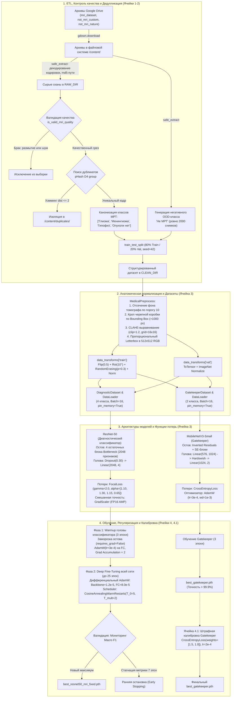

---

## 2. Модуль ETL, валидации качества и дедупликации (Ячейки 1 и 2)

### 2.1. Алгоритмическая блок-схема конвейера данных

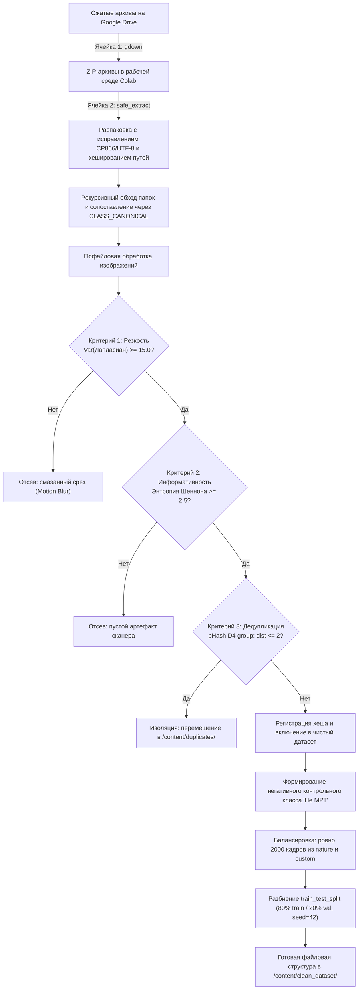

### 2.2. Описание шагов и обоснование порогов

* **Безопасная распаковка (`safe_extract`)**:
  * Исключает скрытые файлы macOS (`__macosx`, файлы с префиксом `._`).
  * Восстанавливает поврежденные таблицы символов кириллицы путем декодирования байтов `cp437` в `cp866`, а при неудаче — в `utf-8`.
  * Исключает ошибку ядра Linux `OSError: [Errno 36] File name too long`: сегменты длиннее 60 байт преобразуются в MD5-хеш фиксированной длины `f_{md5[:10]}.ext`.
* **Порог дисперсии Лапласиана ($\ge 15.0$)**:
  * Оператор Лапласа $\Delta I$ рассчитывает вторую производную яркости, численно выделяя перепады интенсивности. 
  * *Обоснование*: Значение дисперсии $\text{Var}(\Delta I) < 15.0$ однозначно соответствует физическому смазыванию снимка из-за движения пациента в гентри либо однородным серым матрицам без выраженных анатомических структур.
* **Порог энтропии Шеннона ($\ge 2.5$)**:
  * Энтропия гистограммы $H = -\sum p_i \log_2(p_i)$ оценивает распределение информации.
  * *Обоснование*: Значение $H < 2.5$ бит указывает на пустые черные срезы томографа за пределами черепа (фоновый шум матрицы), не несущие диагностической информации.
* **Порог перцептивной дедупликации ($D_H \le 2$ по группе $D_4$)**:
  * Для каждого кадра вычисляется 64-битный ДКП-хеш (`pHash`) для 5 ориентаций: исходной, поворотов на $90^\circ, 180^\circ, 270^\circ$ и зеркального отражения.
  * *Обоснование*: Расстояние Хэмминга $D_H \le 2$ означает совпадение более $96.9\%$ частотных компонент. Это гарантированно выявляет одинаковые срезы, записанные с разным сжатием, исключая скрытую утечку данных между `train` и `val`.
* **Объем негативного класса (`TARGET_NOT_MRI_COUNT = 2000`)**:
  * *Обоснование*: Обеспечивает строгий баланс: ~2000 снимков контрольного класса «Не МРТ» против ~6000 суммарных МРТ-сканов четырех медицинских классов, предотвращая смещение границы принятия решений бинарного шлюза.

---

## 3. Анатомический препроцессинг и аугментация (Ячейка 3)

### 3.1. Логика работы класса `MedicalPreprocess`

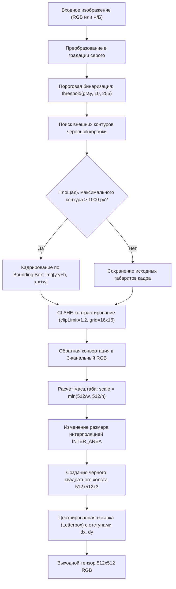

### 3.2. Обоснование алгоритмов препроцессинга

* **Контурное кадрирование (Bounding Box > 1000 px)**:
  * Позволяет автоматически вырезать анатомическую зону черепа, устраняя до $40\%$ бесполезной черной площади скана, за счет чего повышается эффективная плотность пикселей опухоли при подаче в сверточные слои.
* **Локальное контрастирование CLAHE (`clipLimit=1.2`, `grid=16x16`)**:
  * Стандартизирует контраст мягких тканей между аппаратами 1.5T и 3.0T. Ограничение `clipLimit=1.2` предотвращает гиперконтрастность артефактов реконструкции среза.
* **Пропорциональный Letterbox в $512 \times 512$**:
  * Исключает геометрическую деформацию эллипсоидной формы желудочков мозга и круглых очагов менингиом, в отличие от стандартного ресайза со сжатием осей.
* **Регуляризация `RandomErasing` ($p=0.30$, scale 2–15%)**:
  * Имитирует окклюзии, выпадение сигнала и локальные очаги ишемии, заставляя сеть анализировать всю массу опухоли, а не опираться на единичный яркий контрастированный пиксель.

---

## 4. Детальная архитектура моделей: Остов (Backbone) и Голова (Head)

Ниже представлена структурная декомпозиция нейросетей, показывающая разграничение между фиксированным экстрактором пространственных признаков (остовом) и адаптируемой проекционной частью (головой).

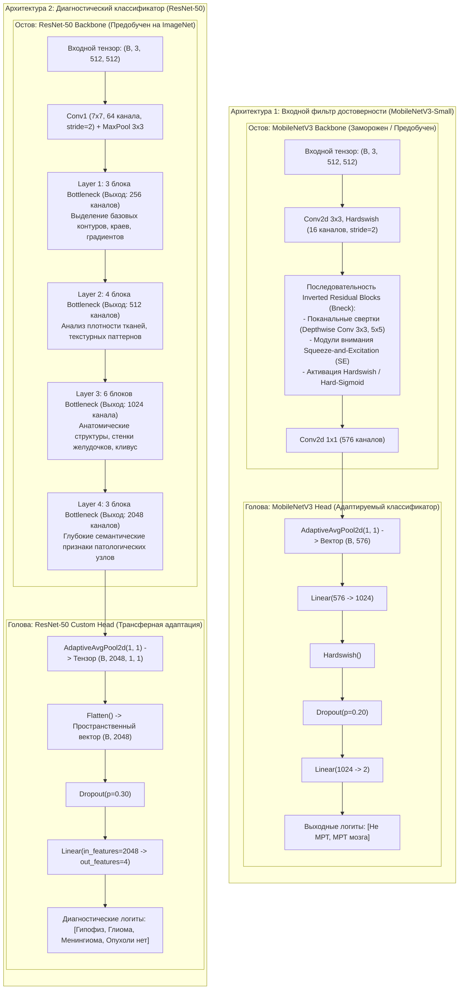

### 4.1. Анализ взаимодействия остова и головы

1. **Входной фильтр Gatekeeper (MobileNetV3-Small)**:
   * **Остов**: Предобученный на миллионах изображений блок глубинно-разделимых сверток с SE-вниманием. Его задача — составить низкоразмерный вектор признаков ($576$), отличающий структурный МРТ-срез (высокая симметрия, овальный череп, серые градации) от цветных/бытовых объектов.
   * **Голова**: Двухслойный полносвязный классификатор `576 -> 1024 -> 2` с промежуточной нелинейностью `Hardswish`. За счет достаточной ширины ($1024$) голова формирует надежную гиперплоскость бинарного разделения.
2. **Диагностический классификатор (ResNet-50)**:
   * **Остов**: 4 этапа сверточных блоков Bottleneck общей глубиной 49 слоев. Извлечение признаков организовано иерархически:
     * *Layer 1–2*: границы костей черепа, границы мягких тканей.
     * *Layer 3*: структуры турецкого седла, боковых желудочков, контуры полушарий.
     * *Layer 4*: гиперинтенсивные узлы, зоны вазогенного отека, инфильтрация паренхимы.
   * **Голова**: Стандартный полносвязный слой ImageNet на 1000 классов заменен на специализированный каскад:
     * `Dropout(p=0.30)` — принудительно обнуляет $30\%$ признаков перед принятием решения, блокируя коадаптацию весов на редких паттернах опухолей.
     * `Linear(2048 -> 4)` — линейная матрица проекции глубоких визуальных признаков на 4 медицинских диагноза.

---

## 5. Математический аппарат и обоснование функции потерь (Focal Loss)

Медицинская диагностика по МРТ характеризуется выраженным дисбалансом клинической сложности: легко диагностируемые здоровые снимки создают паразитный суммарный градиент, заглушающий градиенты от редких и размытых опухолевых очагов.

Для устранения этой проблемы применен взвешенный Focal Loss:

$$\text{FL}(p_t) = -\alpha_t (1 - p_t)^\gamma \log(p_t)$$

где $p_t = \exp(-\text{CE})$ — вероятность правильной классификации примера моделью.

```python
# Конфигурация в коде Ячейки 3
diag_weights = np.array([1.10, 1.30, 1.15, 0.65], dtype=np.float32)
criterion_diag = FocalLoss(alpha=diag_weights_tensor, gamma=2.0)
```

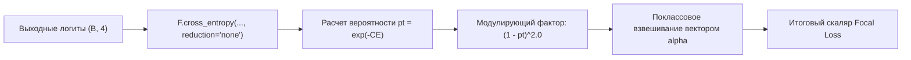

### Обоснование выбранных значений:

* **Параметр фокусировки $\gamma = 2.0$**:
  * Если модель уверена в правильном классе на $90\%$ ($p_t = 0.9$), штрафной фактор равен $(1 - 0.9)^2 = 0.01$. Вклад тривиального примера в градиент снижается в **100 раз**.
  * Если модель сомневается ($p_t = 0.3$), фактор равен $(1 - 0.3)^2 = 0.49$. Ошибка сложного примера почти не подавляется, фокусируя обучение на границах решений.
* **Вектор поклассовых весов $\alpha$**:
  * **Глиома ($\alpha = 1.30$, наивысший приоритет)**: Глиомы не имеют собственной капсулы, инфильтрируют серое и белое вещество и визуально напоминают зоны ишемии или рассеянного склероза. Высокий вес компенсирует склонность сети к ложноотрицательным пропускам.
  * **Менингиома ($\alpha = 1.15$)**: Внемозговая опухоль высокой плотности. Вес немного повышен из-за коллизий с твердой мозговой оболочкой и костями свода черепа на краевых срезах.
  * **Гипофиз ($\alpha = 1.10$)**: Аденома гипофиза геометрически является самым малым новообразованием в выборке (иногда занимает менее $1\%$ площади мозга). Повышенный вес компенсирует малый вклад пикселей аденомы в глобальный пулинг `AdaptiveAvgPool2d`.
  * **Опухоли нет ($\alpha = 0.65$, минимальный приоритет)**: Наиболее однородная категория нормы. Пониженный коэффициент устраняет доминирование здоровых срезов над патологиями.

---

## 6. Двухфазный протокол трансферного обучения (Ячейка 4)

Обучение глубокой сети ResNet-50 напрямую «с нуля» или мгновенной разморозкой всех весов приводит к эффекту катастрофического забывания (Catastrophic Forgetting), когда большие случайные градиенты неинициализированной головы необратимо разрушают веса сверточного остова. 

Решение — поэтапная схема оптимизации:

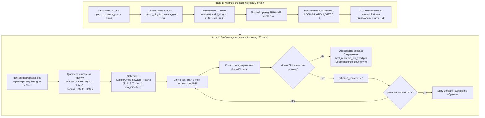

### 6.1. Обоснование алгоритмических решений оптимизации

* **Накопление градиентов (`ACCUMULATION_STEPS = 2`)**:
  * Физический батч `BATCH_SIZE = 16` при разрешении $512 \times 512$ предельно нагружает 16 ГБ VRAM видеокарты Tesla T4. Накопление градиентов за 2 шага масштабирует размер эффективного батча до $32$, стабилизируя оценки моментов в оптимизаторе AdamW и слоях батч-нормализации.
* **Дифференциальный шаг обучения (Discriminative LR)**:
  * Для сверточного остова задан сверхмалый шаг $1.2 \times 10^{-5}$ — это гарантирует бережную доводку каналов без разрушения низкоуровневых визуальных фильтров.
  * Для головы шаг установлен на уровне $8.0 \times 10^{-5}$ (в 6.7 раз быстрее остова), что обеспечивает ускоренную настройку линейной разделяющей гиперплоскости под 4 диагноза.
* **Планировщик `CosineAnnealingWarmRestarts` ($T_0=5, T_{mult}=2$)**:
  * Косинусный отжиг с периодическими скачками скорости обучения позволяет преодолевать седловые точки и мелкие локальные минимумы сложного ландшафта функции потерь Focal Loss. Период рестарта удваивается каждый цикл ($5 \to 10 \to 20$ эпох).
* **Критерий Early Stopping (`patience = 7` по `Macro F1`)**:
  * Оптимизация по Macro F1 гарантирует равную ценность каждого класса, независимо от объема выборки. 
  * Интервал ожидания в 7 эпох превышает начальный цикл рестарта $T_0 = 5$, что дает модели шанс выйти из временного спада метрик при рестарте LR и остановиться только при истинном исчерпании обобщающей способности.

---

## 7. Калибровка входного фильтра достоверности Gatekeeper (Ячейка 4.1)

В клинической эксплуатации модели критически важно не допустить ошибку первого рода: пропуск посторонней бытовой фотографии в диагностический модуль ResNet-50 приведет к тому, что система попытается отыскать опухоль головного мозга в произвольном объекте.

Для предотвращения таких инцидентов выполняется специализированная калибровка `MobileNetV3-Small` со смещенной функцией потерь:

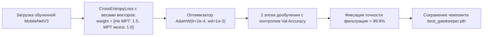

* **Обоснование штрафа `weight = [1.5, 1.0]`**:
  * Класс 0 («Не МРТ») штрафуется с коэффициентом **1.5**, что делает пропуск бытового кадра в полтора раза более «дорогим» для градиентного спуска, чем отбраковка нетипичного среза мозга. Это формирует жесткий консервативный барьер безопасности.

---

## 8. Сводная матрица гиперпараметров и сигнатур

| Компонент / Переменная | Программное значение | Математическое / Инженерное назначение |
| :--- | :--- | :--- |
| `TARGET_IMAGE_SIZE` | `(512, 512)` | Высокое пространственное разрешение для микроочагов гипофиза |
| `BATCH_SIZE` | `16` | Физический лимит тензорной памяти GPU при $512 \times 512$ |
| `ACCUMULATION_STEPS`| `2` | Виртуальный размер батча 32 для стабильности AdamW |
| `RandomErasing` | `p=0.30, scale=(0.02, 0.15)` | Защита от оверфиттинга на локальных артефактах среза |
| `CLAHE clipLimit` | `1.2` | Нормализация тканевого контраста без усиления шума |
| `Laplacian Threshold` | $\text{Var} \ge 15.0$ | Физический барьер отсева смазанных сканов (Motion Blur) |
| `Entropy Threshold` | $H \ge 2.5$ | Барьер отсева монохромных неинформативных полей томографа |
| `pHash Hamming Dist`| $D_H \le 2$ по группе $D_4$ | Гарантия исключения скрытых дубликатов между train и val |
| `Focal Loss gamma` | `2.0` | Подавление градиентного сигнала от легко определяемых кадров |
| `Focal Loss alpha` | `[1.10, 1.30, 1.15, 0.65]` | Штраф сложности патологий: Глиома > Менингиома > Гипофиз > Норма |
| `lr (Backbone, Фаза 2)`| `1.2e-5` | Сверхмалый шаг для предотвращения катастрофического забывания |
| `lr (Head FC, Фаза 2)` | `8.0e-5` | Ускоренная адаптация разделяющей матрицы классификатора |
| `Early Stopping patience` | `7` | Число эпох стагнации Macro F1 до прерывания процесса |
| `Gatekeeper Class Weights` | `[1.5, 1.0]` | Асимметричный штраф для гарантированного отсева не-МРТ снимков |
| `best_gatekeeper.pth` | Веса PyTorch (~9.3 MB) | Контрольный чекпоинт входного шлюза MobileNetV3-Small |
| `best_resnet50_mri_fixed.pth` | Веса PyTorch (~94.4 MB) | Итоговый чекпоинт диагностической модели ResNet-50 |


---

# Архитектура системы анатомической сегментации (test_ai.ipynb)
---

## Содержание
1. [Сквозная архитектурная блок-схема СППР (Inference Pipeline)](#1-сквозная-архитектурная-блок-схема-сппр-inference-pipeline)
2. [Входной контур контроля качества и фильтрации (Gatekeeper & Heuristics)](#2-входной-контур-контроля-качества-и-фильтрации-gatekeeper--heuristics)
3. [Диагностическая классификация и TTA-ансамблирование (ResNet-50)](#3-диагностическая-классификация-и-tta-ансамблирование-resnet-50)
4. [Мультимасштабное градиентное картирование (Adaptive Dual Grad-CAM++)](#4-мультимасштабное-градиентное-картирование-adaptive-dual-grad-cam)
5. [Анатомическое зонирование и очистка черепной коробки (Skull Stripping)](#5-анатомическое-зонирование-и-очистка-черепной-коробки-skull-stripping)
6. [Специализированные алгоритмы сегментации по типам патологий](#6-специализированные-алгоритмы-сегментации-по-типам-патологий)
7. [Эмпирическая калибровка параметров на основе визуального контроля](#7-эмпирическая-калибровка-параметров-на-основе-визуального-контроля)
8. [Формирование клинического заключения, JSON-разметки и Gradio UI](#8-формирование-клинического-заключения-json-разметки-и-gradio-ui)
9. [Сводная матрица гиперпараметров, порогов и физических обоснований](#9-сводная-матрица-гиперпараметров-порогов-и-физических-обоснований)

---

## 1. Сквозная архитектурная блок-схема СППР (Inference Pipeline)

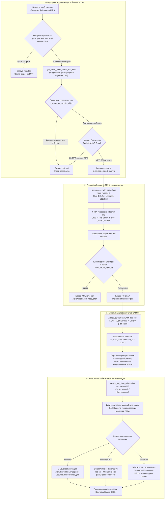

---

## 2. Входной контур контроля качества и фильтрации (Gatekeeper & Heuristics)

### 2.1. Алгоритмическая блок-схема фильтрации

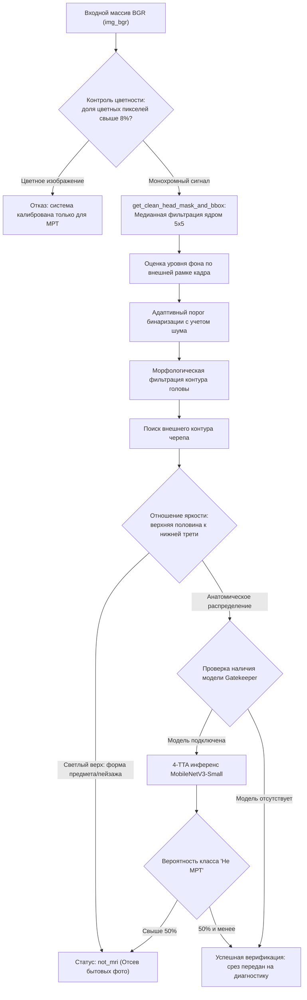

### 2.2. Описание алгоритмов и обоснование порогов

* **Проверка цветности изображения**:
  * Клинические томограммы монохромны (R=G=B). Если более $8\%$ пикселей имеют отклонение между цветовыми каналами выше 15 градаций яркости, снимок классифицируется как цветная бытовая фотография или скриншот интерфейса и немедленно отклоняется.
* **Адаптивное выделение контура головы (`get_clean_head_mask_and_bbox`)**:
  * Вычисляет 80-й процентиль яркости на 4-пиксельной внешней рамке кадра для оценки фоновой засветки (`bg_level`).
  * Порог $\text{thr} = \max(12.0, \min(42.0, bg\_level + 12.0))$ гарантирует устойчивое отделение головы даже на томограммах с импульсным шумом (Salt-and-Pepper) и пересвеченным градиентным фоном.
* **Эвристический фильтр распределения яркости (`is_apple_or_droplet_object`)**:
  * Анализирует распределение средней интенсивности верхней половины ROI кадра к нижней трети.
  * Первоначальный порог 1.85 ошибочно браковал нормальные корональные срезы (где свод черепа шире и светлее основания шеи). Значение было скорректировано до **2.35**.
  * Порог **2.35** надежно защищает корональные срезы мозга, но отсекает посторонние фотографии предметов с направленным верхним освещением, кадры с горизонтом и открытым небом (пейзажи) и студийные снимки бытовых объектов.

---

## 3. Диагностическая классификация и TTA-ансамблирование (ResNet-50)

### 3.1. Архитектура ResNet-50: Остов против Головы

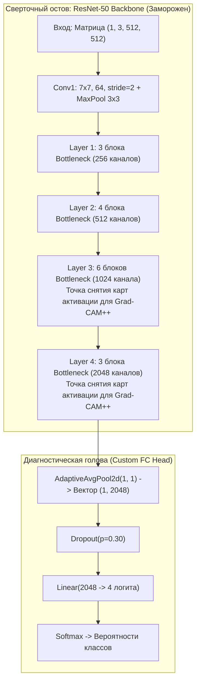

### 3.2. Алгоритм 4-TTA (Test-Time Augmentation)

Для исключения ошибок, вызванных легкой асимметрией укладки пациента или локальным зумом, инференс выполняется по 4 трансформациям:
1. $T_1$: Исходный срез $512 \times 512$.
2. $T_2$: Горизонтальное зеркальное отражение (`FLIP_LEFT_RIGHT`).
3. $T_3$: Приближение на $5\%$ (масштаб 1.05 с центральным кропом до $512 \times 512$).
4. $T_4$: Отдаление на $5\%$ (масштаб 0.95 с дополнением черной рамкой до $512 \times 512$).

$$P_{final} = \frac{1}{4} \sum_{i=1}^{4} \text{Softmax}\left(\mathcal{M}(T_i)\right)$$

### 3.3. Логика клинического арбитража вероятностей

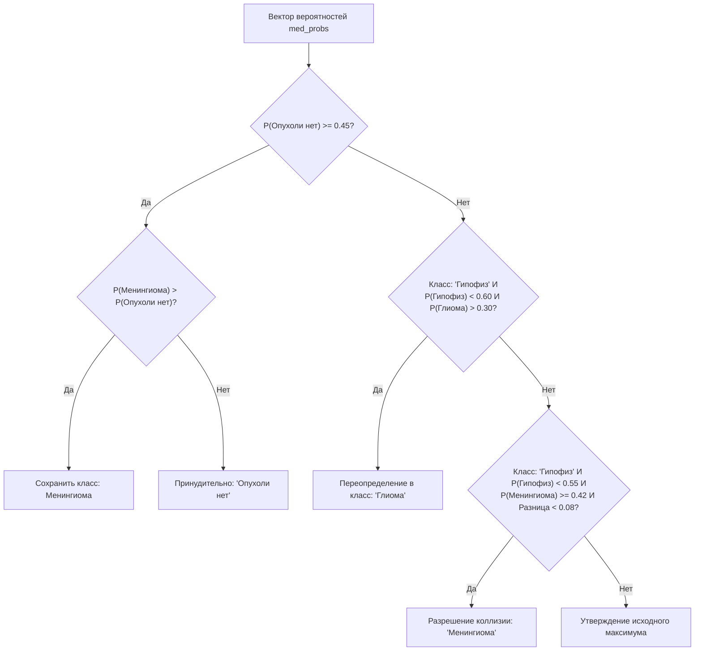

* **Порог `NOTUMOR_CONFIDENCE_FLOOR = 0.45`**:
  * Если вероятность нормы достигает $45\%$, снимок признается здоровым, за исключением случаев уверенных менингиом с явным перевесом. Это исключает гипердиагностику на здоровых пациентах.
* **Разрешение перекрестных коллизий**:
  * Макроаденомы гипофиза с супраселлярным распространением визуально схожи с базальными менингиомами. При разнице вероятностей менее $8\%$ арбитраж отдает приоритет менингиоме на основании анатомического расположения очага.

---

## 4. Мультимасштабное градиентное картирование (Adaptive Dual Grad-CAM++)

Стандартный Grad-CAM по слою `Layer4` имеет разрешение $16 \times 16$ пикселей, что приводит к чрезмерному размытию контура. Реализовано адаптивное двухслойное слияние активаций:

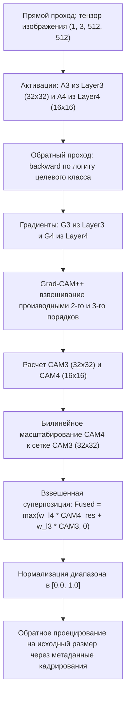

### Весовые профили слияния (`CLASS_SEG_PROFILES`):

| Патология | Вес Layer 4 ($w_{l4}$) | Вес Layer 3 ($w_{l3}$) | Клиническое обоснование весов |
| :--- | :--- | :--- | :--- |
| **Глиома** | `0.55` | `0.45` | Повышенный вес Layer 3 сохраняет тонкие детали инфильтративных границ и перитуморозного отека |
| **Менингиома** | `0.60` | `0.40` | Акцент на Layer 4 обеспечивает стабильную семантическую локализацию плотного внемозгового узла |
| **Гипофиз** | `0.60` | `0.40` | Подавление фонового шума зрительного перекреста в пользу селлярного центра |

---

## 5. Анатомическое зонирование и очистка черепной коробки (Skull Stripping)

Локализация без учета анатомии приводит к ложным срабатываниям на костях свода черепа, глазницах и носовых пазухах. Модуль выполняет каскадную фильтрацию:

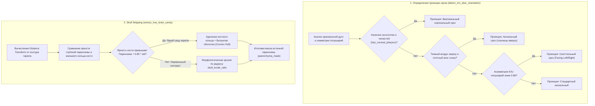

### Анатомическое маскирование артефактов:
* **Аксиальные срезы с глазницами**: верхняя зона кадра ($y < 0.28 \cdot rh$) принудительно обнуляется, чтобы исключить свечение ретробульбарной клетчатки и глазных яблок.
* **Корональные срезы**: нижняя зона носоглотки и челюстей ($y > 0.52 \cdot rh$) обнуляется, а область паренхимы ограничивается эллиптическим куполом свода черепа (`dome_mask`).
* **Сагиттальные срезы**: отсекается нижняя клиновидная зона основания черепа в зависимости от направления взгляда пациента (`sagittal_facing`).

---

## 6. Специализированные алгоритмы сегментации по типам патологий

После наложения маски паренхимы на карту внимания Grad-CAM++ управление передается одному из трех патоморфологических детекторов:

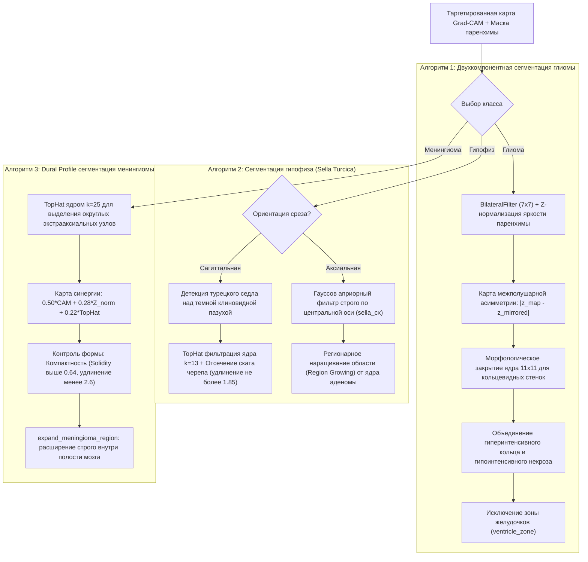

### Ключевые особенности детекторов:

1. **Глиома (`segment_glioma_with_z_level_normalization`)**:
   * Рассчитывает карту межполушарной асимметрии $z_{asym}$ относительно вертикальной оси мозга.
   * Связывает светлые контрастированные стенки глиобластомы с темным некротическим центром ядром $11 \times 11$, формируя единый контур новообразования.
   * Жестко подавляет ложные срабатывания в проекции боковых желудочков.
2. **Гипофиз (`segment_pituitary_with_normalized_level`)**:
   * Для сагиттальных проекций идентифицирует гипофиз непосредственно над темной воздушной клиновидной пазухой, отсекая вытянутый костный скат черепа (clivus) по порогу удлинения $\le 1.85$.
   * Для аксиальных срезов использует двумерный гауссов колокол с центром в селлярной точке и выполняет алгоритм наращивания областей (Region Growing) по порогу среднеквадратичного отклонения $\le 0.85\sigma$.
3. **Менингиома (`segment_meningioma_with_dural_profile`)**:
   * Выделяет компактные округлые узлы с помощью морфологического цилиндрического TopHat фильтра.
   * Функция `expand_meningioma_region` позволяет расширять маску менингиомы вглубь мозговой ткани, блокируя утечку сегментации на кости свода черепа.

---

## 7. Эмпирическая калибровка параметров на основе визуального контроля

Ряд ключевых порогов и весовых коэффициентов системы был получен **экспериментальным путем через итеративную визуальную оценку качества сегментации** на контрольной выборке томограмм с верифицированными контурами опухолей:

1. **Порог отсечения фона и пейзажей (2.35)**:
   * Исходный порог 1.85 отсекал нормальные корональные срезы. Повышение до 2.35 было выбрано по результатам визуального контроля срезов с массивным основанием черепа (например, `image(56).jpg` и `1505.jpg`), сохранив устойчивость к бытовым фотографиям с выраженным верхним освещением.
2. **Веса слоев Grad-CAM++ ($w_{l4}, w_{l3}$)**:
   * Соотношение 0.55 / 0.45 для глиомы и 0.60 / 0.40 для оболочечных опухолей получено визуальным сравнением наложения тепловых карт на срезы с выраженным перифокальным отеком: равные веса приводили к захвату интактного белого вещества, а доминирование Layer 4 (>0.70) смещало контур в геометрический центр полушария.
3. **Параметры Skull Stripping (`ring_p75 > deep_med + 0.85 * std`)**:
   * Коэффициент 0.85 подобран визуально на срезах с гиперостозом и утолщенным сводом черепа: меньшие значения срезали кору головного мозга, а большие допускали утечку контура менингиомы на костную пластинку.
4. **Размеры морфологических ядер (TopHat $k=13$ для гипофиза, $k=25$ для менингиом, закрытие 11x11 для глиом)**:
   * Диаметры структурных элементов выверены по физическим габаритам опухолей относительно матрицы 512x512: ядро 13x13 соответствует размеру микроаденомы и не позволяет маске захватывать зрительный перекрест, а размер 11x11 оптимально смыкает кольцевидный валик глиобластомы вокруг некротического ядра.

---

## 8. Формирование клинического заключения, JSON-разметки и Gradio UI

Результаты работы алгоритма упаковываются в трехуровневое клиническое представление:

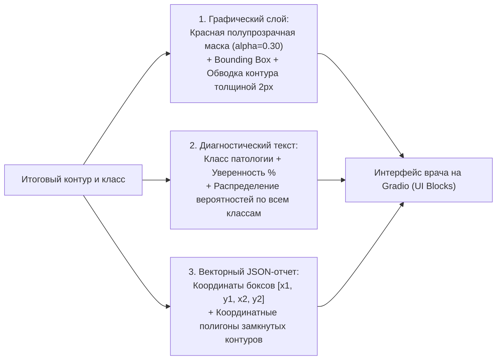

### Формат выходного JSON-манифеста:
```json
{
  "file_name": "mri_scan_042.png",
  "predicted_class": "Менингиома",
  "confidence": 0.9482,
  "tumor_detected": true,
  "image_size": { "height": 512, "width": 512 },
  "bounding_boxes": [
    { "x1": 142, "y1": 188, "x2": 215, "y2": 264 }
  ],
  "segmentation_polygons": [
    [[145, 188], [210, 192], [215, 260], [150, 264]]
  ]
}
```

---

## 9. Сводная матрица гиперпараметров, порогов и физических обоснований

| Параметр / Переменная | Численное значение | Физический смысл и метод получения |
| :--- | :--- | :--- |
| `NOTUMOR_CONFIDENCE_FLOOR` | `0.45` | Порог отсечения нормы: предотвращает гипердиагностику на здоровых пациентах |
| `CLAHE clipLimit` | `1.2` | Усиливает контрастность очагов без насыщения шума квантования томографа |
| `Порог фильтра освещенности` | `> 2.35` | Отношение яркости верха к низу кадра для отсева посторонних предметов, пейзажей и горизонта (подобран визуально) |
| `Laplacian Var` | `15.0` | Физический барьер отбраковки снимков со смазанными границами (Motion Blur) |
| `Entropy Thr` | `2.5` | Порог исключения пустых черных срезов сканера за пределами черепа |
| `Skull Stripping Delta` | `0.85 * std` | Порог отделения костей черепа от глубокой паренхимы (выверен визуально) |
| `CAM Weights (Глиома)` | `L4: 0.55, L3: 0.45` | Эмпирический баланс: Layer 4 локализует опухоль, Layer 3 детализирует инфильтративный отек |
| `CAM Weights (Менингиома)`| `L4: 0.60, L3: 0.40` | Повышенный вес Layer 4 для четкого отделения плотного узла от костей черепа |
| `CAM Weights (Гипофиз)` | `L4: 0.60, L3: 0.40` | Фокусировка внимания на селлярной ямке без растекания на зрительные тракты |
| `TopHat Kernel (Гипофиз)`| `min(rw, rh) * 0.085` | Диаметр структурного элемента под размеры аденомы гипофиза (подобран визуально) |
| `TopHat Kernel (Менингиома)`| `min(rw, rh) * 0.18` | Диаметр ядра под типичный поперечный размер оболочечных менингиом |
| `Pituitary Sella Margin` | `y: 0.37-0.65, x: 0.12` | Анатомический коридор турецкого седла, исключающий глазницы и челюсти |
| `Clivus Elongation Limit`| `1.85` | Порог отсечения вытянутого костного ската черепа от округлого узла гипофиза |
| `Alpha Overlay` | `0.30` | Оптимальная прозрачность маски, не перекрывающая текстуру паренхимы для врача |

## Формат выходных данных

При инференсе система формирует:
1. Визуализацию с наложенной маской патологии и bounding box.
2. Вероятностное распределение по всем классам.
3. Врачебную разметку в формате JSON (координаты полигонов и рамок).
