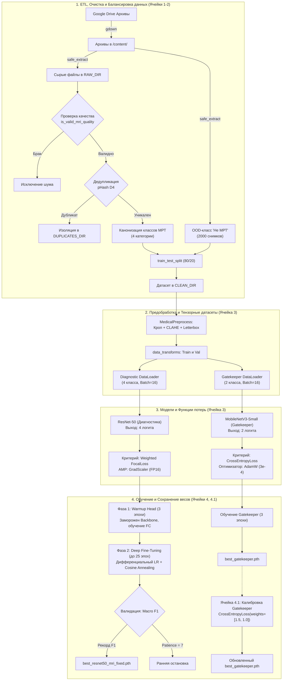
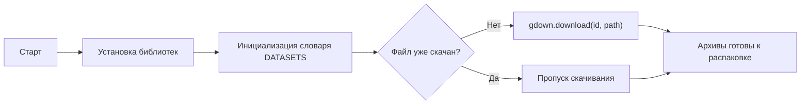
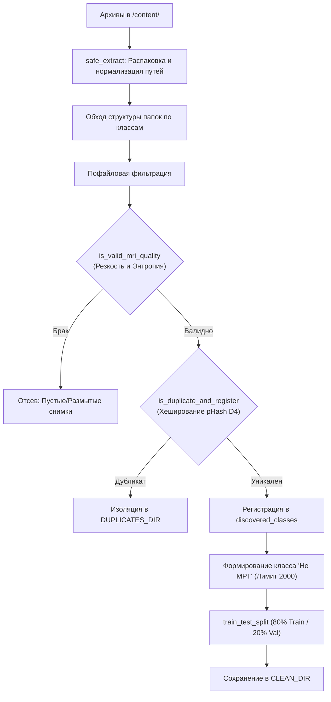
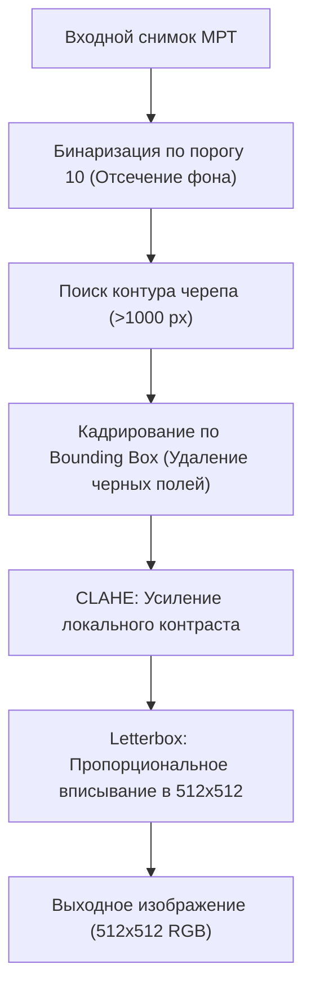
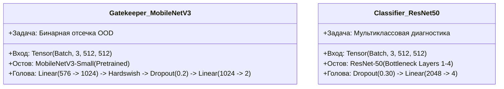
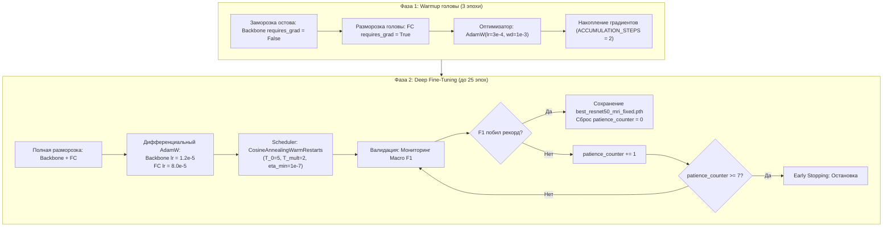
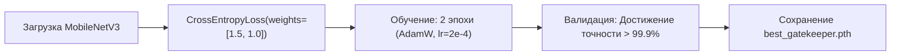

# mri-brain-tumors
Определение наличия и типов опухолей на мрт мозга
# Сегментация и классификация новообразований головного мозга по МРТ

Cистема для детекции и точной локализации опухолей головного мозга (глиома, менингиома, аденома гипофиза) по монохромным срезам МРТ.

[](https://colab.research.google.com/drive/1SDEL3CeAGaQHK7YNh-pnwKLbk5V6PXVR?usp=sharing)
[](https://colab.research.google.com/drive/12biIGSKEKvGF_6BlJyboRFQ5PzI0iJlq?usp=sharing)

---

## Быстрый запуск

Для оперативной проверки работы модели без ожидания обучения и скачивания датасетов:

1. Откройте блокнот **[test_ai.ipynb в Google Colab](https://colab.research.google.com/drive/1SDEL3CeAGaQHK7YNh-pnwKLbk5V6PXVR?usp=sharing)**.
2. В верхнем меню выберите **Среда выполнения (Runtime) -> Выполнить всё (Run all)**.
3. В выводе последней ячейки откроется веб-интерфейс Gradio с публичной ссылкой `*.gradio.live`.

---

# Архитектура и технический разбор пайплайна обучения (Training Pipeline)

Техническое описание пайплайна предобработки, архитектуры нейросетей, математических функций потерь и протоколов обучения для системы классификации патологий головного мозга по МРТ-сканам (`train_ai.ipynb`).

---

## Содержание
1. [Общая блок-схема сквозного пайплайна](#1-общая-блок-схема-сквозного-пайплайна)
2. [Ячейка 1: Инфраструктура и получение данных](#2-ячейка-1-инфраструктура-и-получение-данных)
3. [Ячейка 2: ETL, Очистка, Фильтрация шума и Дедупликация](#3-ячейка-2-etl-очистка-фильтрация-шума-и-дедупликация)
4. [Ячейка 3: Медицинская предобработка, Архитектуры сетей и Функции потерь](#4-ячейка-3-медицинская-предобработка-архитектуры-сетей-и-функции-потерь)
5. [Ячейка 4: Двухфазный протокол трансферного обучения классификатора](#5-ячейка-4-двухфазный-протокол-трансферного-обучения-классификатора)
6. [Ячейка 4.1: Калибровка входного фильтра достоверности Gatekeeper](#6-ячейка-41-калибровка-входного-фильтра-достоверности-gatekeeper)
7. [Сводная таблица параметров и артефактов](#7-сводная-таблица-параметров-и-артефактов)

---

## 1. Общая блок-схема сквозного пайплайна



---

## 2. Ячейка 1: Инфраструктура и получение данных

### 2.1. Назначение
Инициализация рабочего окружения в Google Colab, установка зависимостей (`albumentations`, `imagehash`, `opencv-python`, `gradio`) и автоматическое скачивание архивов датасета с Google Drive по прямым идентификаторам через `gdown`.



### 2.2. Используемые переменные и структура словаря
* `DATASETS` (`dict[str, str]`): маппинг локальных путей назначения и Google Drive ID:
  * `mri_dataset.zip` (`1fQh-pwXNEEOsVvvEz9xUZcPfsnVnhgSs`) — основной набор МРТ-сканов с патологиями и нормой.
  * `not_mri_custom.zip` (`1HNkX3akvRtW9Thkj8DmFeYOUpcL9CvbC`) — пользовательские немедицинские снимки для проверки устойчивости.
  * `not_mri_nature.zip` (`1fGczBDMF3QO-GE55spClLMYD1htKN7jc`) — выборка природных и бытовых объектов (ImageNet).

---

## 3. Ячейка 2: ETL, Очистка, Фильтрация шума и Дедупликация

### 3.1. Логика этапа
Сырые открытые медицинские данные содержат структурные дефекты:
1. **Коллизии путей и имен**: поврежденные кодировки (DOS/Windows кириллица), системный мусор macOS (`__MACOSX`, `._*`) и пути длиннее 60 байт, вызывающие сбои в Linux.
2. **Артефакты сканирования**: размытые кадры от движений пациента и пустые срезы без анатомических структур.
3. **Утечки данных (Data Leakage)**: дублирующиеся срезы, повернутые на $90^\circ, 180^\circ, 270^\circ$ или зеркально отраженные, попадающие одновременно в обучающую и валидационную выборки.



### 3.2. Алгоритмы и обоснование порогов

#### 1. Функция `safe_extract(zip_path, extract_to)`
* Фильтрует артефакты `__macosx` и префиксы `._`.
* Выполняет двухступенчатую трансляцию кодировок: `cp437` $\to$ `cp866`, а при неудаче $\to$ `utf-8`.
* Очищает пути от запрещенных символов `*?\"<>|:`.
* Для сегментов пути длиннее 60 байт генерирует безопасный MD5-хеш имени: `f_{md5[:10]}.ext`.

#### 2. Функция `is_valid_mri_quality(image_path)`
Отсекает неинформативные кадры по двум физическим критериям:
* **Дисперсия оператора Лапласа**: $\text{Var}(\Delta I) \ge 15.0$
  * *Обоснование*: Лапласиан вычисляет вторую производную яркости, отражая резкость контуров. Сканы с $\text{Var} < 15.0$ лишены четких границ тканей из-за движения пациента (motion blur) либо представляют собой сплошные серые артефакты.
* **Энтропия Шеннона распределения яркости**: $H = -\sum p_i \log_2(p_i) \ge 2.5$
  * *Обоснование*: $H < 2.5$ бит соответствует почти монохромным черным срезам сканера за пределами черепной коробки, не содержащим информации о тканях мозга.

#### 3. Функция `is_duplicate_and_register(image_path, hash_threshold=2)`
* Для каждого изображения вычисляется перцептивный хеш ДКП (`imagehash.phash`) по 5 трансформациям группы симметрии квадрата $D_4$: оригинал, повороты на $90^\circ, 180^\circ, 270^\circ$ и горизонтальное отражение.
* Сравнение по расстоянию Хэмминга: $D_H(h_1, h_2) = \sum (h_1 \oplus h_2)$.
* *Обоснование порога $D_H \le 2$*: для 64-битного хеша различие не более 2 бит означает совпадение структуры на $96.9\%$. Это позволяет отсеивать идентичные срезы, сохраненные с разной компрессией JPEG или легким изменением яркости, исключая утечку данных между выборками.

#### 4. Балансировка класса «Не МРТ» (`TARGET_NOT_MRI_COUNT = 2000`)
* *Обоснование*: предотвращает доминирование негативного класса над медицинскими классами (в среднем ~1200–1600 снимков на класс), поддерживая баланс при обучении бинарного фильтра.

---

## 4. Ячейка 3: Медицинская предобработка, Архитектуры сетей и Функции потерь

### 4.1. Алгоритм класса `MedicalPreprocess`
Вместо грубого сжатия изображения, приводящего к искажению геометрических пропорций новообразований, применяется четырехэтапная нормализация:



* **Кроп по контуру ($>1000\text{ px}$)**: удаляет внешние черные поля томографа, концентрируя емкость сверточной сети на структурах мозга.
* **CLAHE (`clipLimit=1.2`, `tileGridSize=(16, 16)`)**: адаптивное выравнивание гистограммы по блокам.
  * *Обоснование*: нормализует визуальный контраст мягких тканей между томографами разной индуктивности (1.5T и 3.0T). Порог `clipLimit=1.2` исключает искусственное усиление фонового шума матрицы томографа.
* **Letterbox Padding**: вписывание с сохранением исходного соотношения сторон и дополнением краев нулями до разрешения $512 \times 512$.

### 4.2. Математическое обоснование параметров Focal Loss

Для компенсации разной сложности распознавания патологий используется взвешенный Focal Loss:

$$\text{FL}(p_t) = -\alpha_t (1 - p_t)^\gamma \log(p_t)$$

где $p_t$ — уверенность модели в истинном классе.

```python
# Конфигурация в коде
diag_weights = np.array([1.10, 1.30, 1.15, 0.65], dtype=np.float32)
criterion_diag = FocalLoss(alpha=diag_weights_tensor, gamma=2.0)
```

#### Обоснование гиперпараметров:
1. **Степень фокусировки $\gamma = 2.0$**:
   * Для легко определяемых снимков с высокой уверенностью ($p_t = 0.9$) модулирующий множитель $(1 - 0.9)^2 = 0.01$ снижает вклад ошибки в 100 раз. Сеть концентрирует градиенты на пограничных и сложных клинических случаях.
2. **Вектор весов $\alpha$**:
   * **Глиома ($\alpha = 1.30$, максимальный приоритет)**: обладает диффузными, нечеткими границами, инфильтративным ростом и схожестью с инфарктами или отеками. Максимальный вес устраняет склонность сети пропускать данный тип опухоли.
   * **Менингиома ($\alpha = 1.15$)**: имеет четкие экстрааксиальные границы, но часто прилежит к твердой мозговой оболочке и костям свода черепа, вызывая коллизии сегментации.
   * **Гипофиз ($\alpha = 1.10$)**: четко локализован в турецком седле, но имеет наименьшую геометрическую площадь среди всех патологий, из-за чего микроаденомы создают слабый градиентный сигнал.
   * **Опухоли нет ($\alpha = 0.65$, минимальный приоритет)**: самый визуально однородный мажоритарный класс нормы. Заниженный вес не позволяет модели в спорных ситуациях уходить в безопасное предсказание «патологии нет».

### 4.3. Архитектуры моделей



* **MobileNetV3-Small (Gatekeeper)**: легковесная архитектура для нулевого барьера инференса. Отсекает не-МРТ снимки до запуска тяжелой аналитики.
* **ResNet-50 (Диагностический классификатор)**: 48 сверточных слоев с остаточными связями (residual connections) обеспечивают детализацию признаков опухолевых тканей без затухания градиента при разрешении $512 \times 512$.

---

## 5. Ячейка 4: Двухфазный протокол трансферного обучения классификатора

Для сохранения предобученных на ImageNet низкоуровневых визуальных фильтров (границы, градиенты, текстуры) и адаптации глубоких слоев используется двухфазная схема обучения:



### 5.1. Обоснование параметров и алгоритмических механик

#### 1. Накопление градиентов (`ACCUMULATION_STEPS = 2`)
* *Обоснование*: Разрешение $512 \times 512$ с ResNet-50 ограничивает физический размер пакета на GPU T4 значением `BATCH_SIZE = 16`. Накопление градиентов за 2 шага формирует виртуальный размер пакета:
  $$\text{Effective Batch Size} = 16 \times 2 = 32$$
  Это обеспечивает стабильную оценку градиента и корректную работу слоев Batch Normalization.

#### 2. Дифференциальный шаг обучения (Discriminative Learning Rates)
* `lr_backbone = 1.2e-5`: сверхнизкий шаг для сверточного остова предотвращает разрушение предобученных обобщенных весов (защита от катастрофического забывания).
* `lr_fc = 8.0e-5` (в 6.7 раз выше остова): обеспечивает ускоренную настройку классификационной матрицы разделения под 4 медицинских класса.

#### 3. Планировщик `CosineAnnealingWarmRestarts` (`T_0 = 5`, `T_mult = 2`)
* *Обоснование*: Косинусный отжиг с периодическими перезапусками каждые 5 эпох (с последующим удвоением периода: $5 \to 10$) помогает выбивать оптимизатор из неглубоких локальных минимумов функции потерь на этапе глубокой доводки.

#### 4. Ранняя остановка (`patience = 7`)
* *Обоснование*: С учетом периода рестарта $T_0 = 5$, интервал терпения в 7 эпох позволяет модели полностью пройти цикл временного спада метрик при рестарте LR и гарантированно зафиксировать факт стагнации сходимости. Оптимизация ведется строго по метрике `Macro F1`, устойчивой к дисбалансу классов.

---

## 6. Ячейка 4.1: Калибровка входного фильтра достоверности Gatekeeper

### 6.1. Назначение и асимметрия штрафов
Ложноположительный допуск бытовой фотографии в контур классификатора (ошибка первого рода для фильтра) недопустим, так как модель попытается классифицировать бытовой предмет как опухоль мозга. Поэтому выполняется калибровка `MobileNetV3-Small` со смещенными весами потерь:



* **Штраф весов `weights = [1.5, 1.0]`**:
  * Класс 0 («Не МРТ»): вес **1.5** — штраф за ошибку пропуска не-МРТ снимка в полтора раза выше стандартного.
  * Класс 1 («МРТ мозга»): вес **1.0**.

---

## 7. Сводная таблица параметров и артефактов

| Сущность | Программное значение | Назначение и обоснование |
| :--- | :--- | :--- |
| `TARGET_IMAGE_SIZE` | `(512, 512)` | Оптимальное разрешение для распознавания мелких аденом гипофиза без критического падения FPS |
| `BATCH_SIZE` | `16` | Физический предел памяти видеокарты уровня T4 (16 GB VRAM) для матриц $512 \times 512$ |
| `ACCUMULATION_STEPS`| `2` | Формирование виртуального пакета размером 32 для стабилизации стохастического градиента |
| `RandomErasing` | `p=0.30, scale=(0.02, 0.15)` | Имитация локальных артефактов и закрытия зон сканирования, защита от оверфиттинга |
| `CLAHE clipLimit` | `1.2` | Усиление контраста опухолевых очагов без зашумления фоновых структур матрицы МРТ |
| `Focal Loss gamma` | `2.0` | Подавление вклада простых примеров в градиент |
| `Focal Loss alpha` | `[1.10, 1.30, 1.15, 0.65]` | Штрафная компенсация клинической сложности классов (приоритет: Глиома > Менингиома > Гипофиз > Норма) |
| `lr_backbone` | `1.2e-5` | Медленная доводка сверточных фильтров без разрушения признаков ImageNet |
| `lr_fc` | `8.0e-5` | Ускоренная подгонка проекционного слоя под медицинские распределения |
| `patience` | `7` | Предел эпох без прогресса Macro F1 до активации Early Stopping |
| `best_gatekeeper.pth` | Веса PyTorch (~9.3 MB) | Контрольный чекпоинт фильтра достоверности сканов |
| `best_resnet50_mri_fixed.pth` | Веса PyTorch (~94.4 MB) | Финальный чекпоинт 4-классового диагностического классификатора |


## Формат выходных данных

При инференсе система формирует:
1. Визуализацию с наложенной маской патологии и bounding box.
2. Вероятностное распределение по всем классам.
3. Врачебную разметку в формате JSON (координаты полигонов и рамок).
